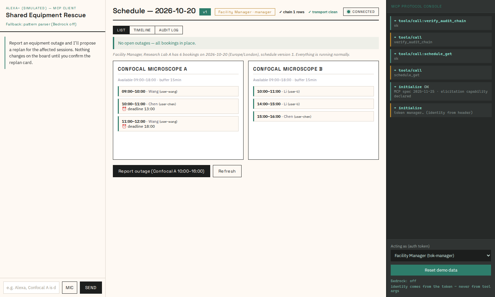
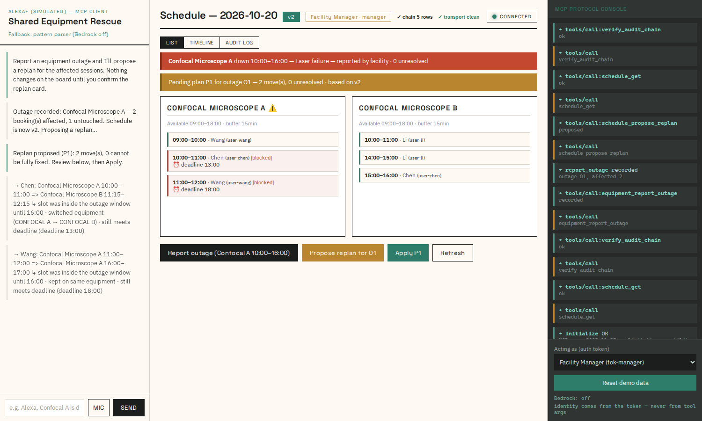
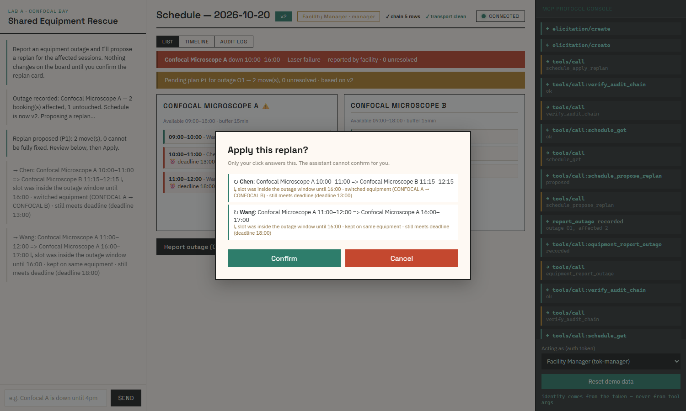
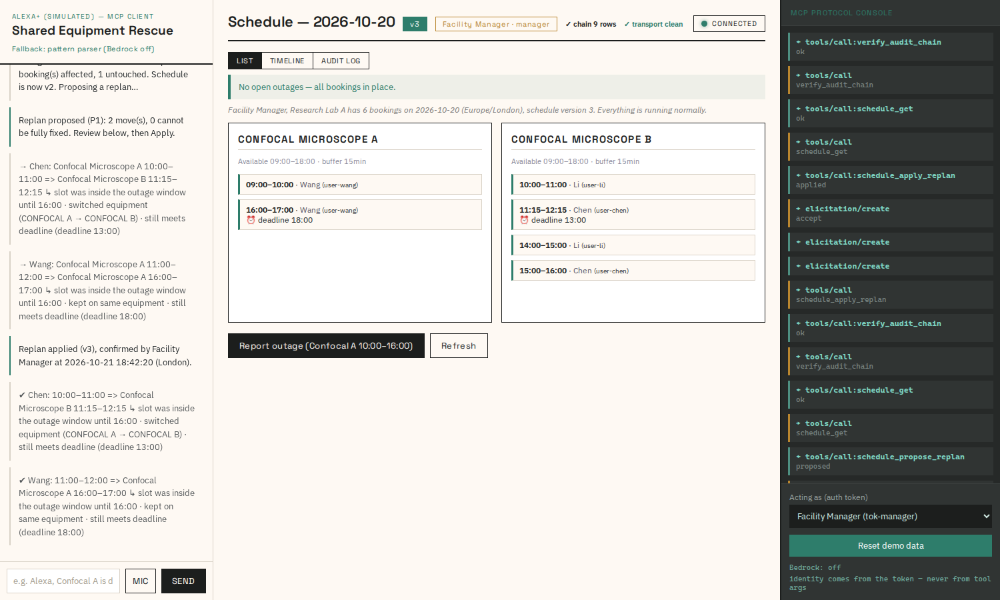
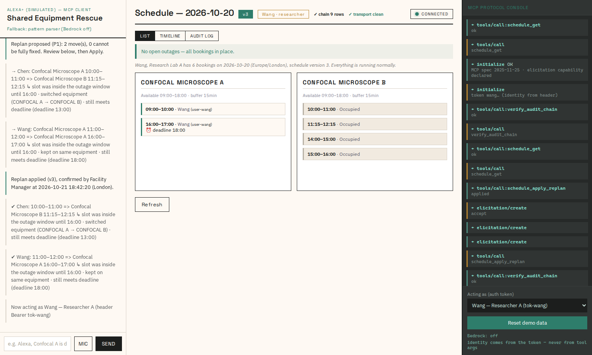

# Shared Equipment Rescue / 共享儀器搶救

<div align="center">

**🌐 [English](#shared-equipment-rescue) · [繁體中文](#共享儀器搶救)**

</div>

> Both versions are kept in this file so nothing goes stale in two places:
> the English section is the reference, the Chinese section is a faithful
> translation of the same content (same commands, same numbers, same images).

---

# Shared Equipment Rescue

**A facility manager's AI copilot for shared-instrument outage recovery — a self-hosted MCP 2025-11-25 server that detects every booking an outage breaks, proposes a rule-checked replan, and never writes a single change without explicit human confirmation (MCP elicitation, human-in-the-loop).**

Amazon "Build, Ship, Shape" hackathon entry — **Alexa+ primary track** + **AWS Builder challenge** (Amazon Bedrock).

## What it does

When a confocal microscope (or any shared instrument) goes down mid-day, a manager normally rebooks six papers by hand. This server does the whole recovery loop over MCP:

1. **Report** the outage → engine instantly marks affected bookings `blocked`, bumps `schedule_version`, writes an audit log row.
2. **Propose** a replan → greedy scheduler searches 15-minute increments, FIFO by deadline, enforcing operating hours, per-user equipment permissions, personal calendars, hard deadlines, and a 15-minute post-session buffer — changes carry machine-readable reason codes; impossible items return **per-equipment `earliest_possible` diagnostics** (`available_only_after`, `available_after_deadline` + `deadline_would_need at_least "12:15"`, `no_permission` blockers), never a bare failure.
3. **Apply** → the tool calls `ctx.elicit()` and **refuses to mutate** until a human confirms in the client UI. Decline / cancel / unsupported client → `not_confirmed`, zero side effects, plan stays `proposed`.
4. **Idempotency everywhere**: `plan_id` = `(outage_id, based_on_version)`, monotonic `schedule_version`, stale proposals rejected (`plan_stale`), re-apply → `already_applied`.

## The demo, frame by frame

The six frames below are the actual demo (regenerated from this build by
`tools/shoot_screenshots.py`; `tests/test_screenshots_current.py` fails if
they ever drift from what the code renders).

**1 — the board, straight after `initialize`** — six bookings across two
confocals, and the right-hand panel showing the real MCP traffic
(`tools/call` → `ok`, protocol `2025-11-25`, identity taken from the header):



**2 — one tool call, the outage is recorded** — the version badge jumps to
`v2`, the outage banner appears and B2/B4 are marked `blocked`:


**3 — the proposal** — Chen moves to Confocal B 11:15–12:15, Wang to
Confocal A 16:00–17:00, each with a machine-readable reason
(`switched equipment (CONFOCAL A → CONFOCAL B)`, `still meets deadline`):



**4 — the human-in-the-loop gate** — the server sends a real MCP
`elicitation/create`; the confirmation card is answered by a click and
nothing else. No spinner on top of the decision:



**5 — applied, `v3`** — the audit row records who confirmed and when
(London time):



**6 — the same board as a researcher** — Wang sees his own new 16:00 slot
while everyone else's booking is masked as `Occupied`:



## Quick start

```bash
pip install -r requirements.txt        # mcp==1.30.0, uvicorn[standard], pydantic>=2.5
python -m mcp_server                   # → http://127.0.0.1:8765/mcp
```

Optional flags: `python -m mcp_server --host 127.0.0.1 --port 8765 --db server.db`

### Talk to it with any MCP client

```python
from mcp import ClientSession
from mcp.client.streamable_http import streamablehttp_client

headers = {"authorization": "Bearer tok-manager"}   # header-only auth

async def confirm_outage(message, schema):          # MUST be async
    # message lists what will move; schema is {"confirm": bool}
    return ElicitResult(action="accept", content={"confirm": True})

async with streamablehttp_client("http://127.0.0.1:8765/mcp", headers=headers) as (r, w, _):
    async with ClientSession(r, w, elicitation_callback=confirm_outage) as s:
        await s.initialize()
        res = await s.call_tool("schedule_get", {})        # res.structuredContent
```

Clients **without** an elicitation callback are safe by design: apply returns `not_confirmed` and nothing changes.

### Demo tokens (Authorization: Bearer …)

| token | role | can see / do |
|---|---|---|
| `tok-manager` | manager | both confocals; write tools |
| `tok-chen` | researcher | confocal-a + confocal-b |
| `tok-wang` | researcher | confocal-a only |
| `tok-li` | researcher | confocal-b only |

Identity comes **only** from the per-request header — never from tool arguments.

## The eight tools (contracts/)

`contracts/tools.json` holds the machine-readable input/output schemas (generated verbatim from the live tool registry, locked by tests). `contracts/examples/` holds 13 frozen end-to-end fixtures replayed byte-exact by the test-suite deep-equality lock — any drift in a fixture or a schema breaks the build:

| tool | writes? | notes |
|---|---|---|
| `schedule_get` | no | full day view, role-masked, narration in `message` |
| `equipment_report_outage` | **yes** | manager-only; duplicates rejected |
| `schedule_propose_replan` | no (creates plan row) | stale-check + idempotent plan_id |
| `schedule_apply_replan` | **yes** | **elicitation-gated**; human confirm required |
| `schedule_audit_get` | no | **who did what, when** — managers see the full trail; researchers see own actions + public events (outages, replans, applies, resets). Token hints show only a truncated non-identifying fragment (`manager…`, `chen…`), never a full secret. |
| `verify_audit_chain` | no | manager-only; recomputes the SHA-256 hash chain over the audit trail and flags any edit, deletion or splice (`broken_at` row). |
| `reset_demo_data` | **yes** | manager-only; restores seed schedule (version 1); clears the audit trail and records the reset itself as the final entry |
| `debug_confirm` | no | echoes elicitation wiring for client bring-up |

## Engine guarantees (§10 rules)

1. Only `movable` bookings affected by the outage are rescheduled.
2. FIFO by deadline; ties by original start.
3. 15-min slot grid; original equipment preferred if still available ≥ required duration.
4. Hard constraints: operating hours, per-user equipment grants, personal calendar (no double-booking), hard deadline, 15-min post-session cleaning buffer.
5. Greedy, determinstic — no randomness, no LLM decisions in the write path.

**Demo day (2026-10-20, Europe/London):** outage on Confocal A 10:00–16:00 ⇒ `B2 → Confocal B 11:15–12:15` (first slot after Li's immovable B3), `B4 → Confocal A 16:00–17:00` (after outage). Failing both (deadline 11:30 scenario) yields per-equipment diagnostics: B could host 11:15–12:15 `available_after_deadline` + `deadline_would_need at_least 12:15`; A shows `no_slot_today` — while B4 still relocates to A 16:00 in the same plan.

## LLM layer (dual-mode, §7 of the plan)

`mcp_server/llm.py` — **no AWS credentials? Everything still works.**

- `SER_LLM_MODE=auto|scripted|bedrock` (default `auto`).
- Bedrock path: single `Converse` call with a system prompt that hard-binds the six prohibitions (never invent facts, never override the engine, never reorder tool args, never claim authority, never unmask other users, never claim to be the system of record — the DB is). Any failure → scripted fallback, so the demo cannot break live.
- Scripted path: deterministic narration built only from returned JSON facts.

## Architecture

```
Browser (web/)                MCP host/agent (Bedrock or any MCP client)      This repo
┌────────────────┐            ┌──────────────────────────┐   Streamable      ┌─────────────────────────┐
│ schedule cards │  ──MCP──▶  │ agent loop, tool calls,  │  ──HTTP+MCP──▶    │ FastMCP server           │
│ elicitation UI │            │ elicitation prompt       │   127.0.0.1:8765  │  engine + SQLite + audit │
└────────────────┘            └──────────────────────────┘                   └─────────────────────────┘
```

## Browser demo (web/)

```bash
python -X utf8 tools/dev_server2.py     # MCP server on http://127.0.0.1:8765/mcp (fresh temp DB each boot)
cd web && python app.py --port 8080     # web shell on http://127.0.0.1:8080 (any --port works)
```

Or run the MCP server against a persistent DB file: `python -X utf8 -m mcp_server`.

`web/` is part of this repo (an MCP Streamable-HTTP client UI): FastAPI serves the
static client and same-origin-proxies `/mcp` to the MCP server, streaming `GET /mcp`
SSE chunk-by-chunk so server-initiated `elicitation/create` reaches the browser live.
The apply confirmation card is answered only by a human click — the demo identity is
carried solely in the `Authorization: Bearer <token>` header, never in tool arguments.

## Hardening (OWASP MCP Security Cheat Sheet)

Transport-level header validation runs at **both** layers and rejects
DNS-rebinding browsers / cross-site attackers before any MCP logic executes:

| layer | check | behavior |
|---|---|---|
| web proxy (`web/app.py`) | `Origin` + `Host` allowlist | present-but-unrecognized → JSON-RPC error `-32002`, HTTP 403; absent Origin allowed (native MCP clients send none). Any **loopback** origin/host is accepted on any port, so `--port` other than 8080 works; foreign hosts/origins stay blocked (DNS-rebinding defence) |
| MCP server (`mcp_server/server.py`) | pure-ASGI `TransportGuardMiddleware` wrapping the Streamable HTTP app | same policy for anyone bypassing the proxy |

Plus a structured **audit trail** (`audit_log` SQLite table, `schedule_audit_get`
tool, "Audit log" tab in the web UI): every tool call records actor, role, tool,
result, detail and a truncated token hint. Writes are best-effort and can never
break a tool response. Production-grade details: **WAL journal mode** (concurrent
reads never block on the write lock), **cursor pagination** (`before_id` +
`tool_filter` on `schedule_audit_get`, `next_before_id` cursor returned), a
**10k-row rolling retention** enforced after every audit insert, and a **SHA-256
hash chain** over the trail — `verify_audit_chain` (manager-only) recomputes the
chain and flags edits, deletions or splices, and the UI shows a live
"✓ chain N rows" / "⚠ tamper @row" badge. Both the MCP guard middleware and the
web proxy apply a **per-IP token-bucket rate limit** (~4 req/s, burst 16) that
answers floods with HTTP 429 / `-32002` instead of letting them through. The
audit tab carries a **tool filter dropdown** and 10-second auto-refresh; each
worker thread reuses one **thread-local SQLite connection**; deployments on a
different proxy port / HTTPS tunnel can whitelist their browser origin via
`SER_ALLOWED_ORIGINS` (comma-separated exact origins, honoured by both layers).

Tier 3 additions: every audit row also stores a **structured JSON mirror**
(`detail_json`) of the event — `{tool, result, ...structured keys}` such as
`plan_id`, `blocked_count` or `schedule_version` — exposed through
`schedule_audit_get` and rendered as an expandable `json` chip in the audit tab,
so SIEM-style log scrapers get machine-readable fields without parsing prose
(the mirror is best-effort and excluded from the hash chain, so its structure
can evolve without invalidating tamper evidence). A **`GET /metrics`**
observability endpoint exists on both layers (MCP :8765 and the web proxy
:8080, which aggregates both): process uptime, token-bucket state, schedule
version, table row counts and journal mode — JSON, `no-store`, before any MCP
session resources are consumed. The UI ships a **deep link** (`/#audit` /
`/?view=audit`) that opens the audit tab pre-connect, covered by a
**Playwright suite** (28 browser checks covering the full outage→propose→confirm→apply loop: identity select, panels, equipment report, dev console, confirm card, decline path, applied v3, responsive layout - mutation-verified: each check was shown to fail when its defect is injected).


```bash
python -X utf8 -m pytest tests/ -q      # 69 passed
```

- `test_engine.py` (12): slot search, buffer semantics, permissions, the B4-scoping engine fix, outage-visible-to-search regression, and the choice-key tie-break (earliest start wins; the original equipment wins an exact tie).
- `test_engine_edges.py` (6): boundary edges — half-open intervals, zero-duration, zero-buffer adjacency, unknown equipment.
- `test_contract.py` (17): schema equality against `contracts/tools.json` + byte-exact replay of 13 frozen examples under `SER_FROZEN_NOW=2026-10-20T12:00:00+01:00`.
- `test_server.py` (8): **real uvicorn + real MCP client** over Streamable HTTP — token/tool tables, full outage→propose→apply→`already_applied` loop, elicitation declined leaves the plan untouched, `plan_stale` after version bump, reset, and a **crash/restart cycle** that proves outage + pending plan survive a server restart (subprocess, same SQLite file).
- `test_llm.py` (10): mode selection with/without credentials, prohibition wording, graceful Bedrock failure fallback.
- `test_accountability.py` (7): real-client audit-trail checks — researcher public-visibility SQL boundary, concurrent double-apply applies exactly once (TOCTOU), 403 origin/host rejections land in the hash-chained transport ledger, the ledger survives `reset_demo_data`, a replayed apply leaves an audit row with the chain verifying green, audit pagination drops no row at any page boundary (limit 1/2/3 walks over 5 seeded rows), and `debug_confirm` elicitation outcomes are audited.
- `test_web_proxy.py` (6): the `web/` layer — loopback `Origin`/`Host` accepted on any port, foreign hosts/origins still 403, a real MCP client relayed through the proxy sees all 8 tools and a working `schedule_get`, `/metrics` aggregates both layers, and a dead upstream returns 502 with a restart hint.
- `test_video_walk.py` (1, 29 scene checks): drives the real UI through **the demo video script beat by beat** — the six bookings and two confocals, the version bump to v2 with the outage banner, both proposed moves with machine-readable reasons, the confirm card naming the human-in-the-loop rule, Cancel leaving the version untouched, Confirm reaching v3, the identity switch masking other people's slots as "Occupied", and the audit tab with zone-labelled timestamps — so the recording cannot show something the narration does not claim. Needs Playwright; skips cleanly where no browser can launch.
- `test_screenshots_current.py` (1): the committed screenshots in `docs/screenshots/` must still show what the build renders today — it re-renders the same scenes and compares the recorded text, so the images in the README cannot silently go stale. Needs Playwright; skips cleanly where no browser can launch.
- `test_readme_i18n.py` (1): the English and Chinese sections of this file must agree — same commands, same images, same identifiers, same numbers. A bilingual README that drifts is worse than none, because a reader cannot tell.

Windows note: use `python -X utf8` to keep pytest output clean.

## Demo screenshots

```bash
python -X utf8 tools/shoot_screenshots.py
```

Regenerates the six demo screenshots from the current build, one per beat of
the video script (initial board, outage, proposal, confirm card, applied, and
the identity switch). It boots its own servers on ephemeral ports, so it never
disturbs a running demo.

It writes two copies: `docs/screenshots/` (version-controlled — what the README
shows and what a judge sees) and `web/` (the live capture, gitignored — your
recording scratch). Alongside the images it writes `docs/screenshots/manifest.json`,
the text each frame displayed; `tests/test_screenshots_current.py` re-renders
the same scenes and compares the text, so a committed screenshot can never
silently go stale.

## Development docs

- `docs/friction-log.md` — 7 hard-won findings (SSE-only elicitation, async-callback requirement, `Context.request_context.request.headers`, engine visibility fix, `SER_FROZEN_NOW` clock freeze).
- `docs/product-feedback.md` — MCP-ecosystem observations (elicitation gaps, json_response hazard).
- `COLLAB/CONTRACT-FROZEN.md` — the partner contract; `COLLAB/OUTBOX.md` has the client wiring guide.
- `tools/check_readme_i18n.py` — keeps this file's two language sections in sync (code blocks, images, identifiers, numbers). Run it after editing either side; `tests/test_readme_i18n.py` runs it as part of the suite.

## Tech choices

| Component | Choice | Why |
|---|---|---|
| MCP SDK | `mcp==1.30.0` (FastMCP) | official, 2025-11-25 spec, elicitation support |
| Transport | Streamable HTTP (SSE responses) | required for server→client elicitation |
| DB | SQLite (`server.db`) | transactional versioning + audit log, zero ops |
| Agent model | Amazon Bedrock (Claude) | AWS Builder challenge; scripted fallback keeps demo offline-safe |
| Narration | Bedrock Converse / scripted | dual-mode §7 |

## License

MIT — see LICENSE. Synthetic demo data; not production-hardened.

---

# 共享儀器搶救

**共用儀器故障復原的 AI 助手 —— 一個自架的 MCP 2025-11-25 伺服器：偵測故障會影響哪些預約、提出通過規則檢查的重排方案，而且在人類明確確認之前，絕不寫入任何變更（MCP elicitation，人類在環）。**

Amazon「Build, Ship, Shape」黑客松參賽作品 —— **Alexa+ 主賽道** ＋ **AWS Builder 挑戰**（Amazon Bedrock）。

## 它在做什麼

當共軛焦顯微鏡（或任何共用儀器）白天中途故障，管理員通常得手工改期六篇論文。這個伺服器用 MCP 跑完整條復原迴路：

1. **回報**故障 → 引擎立刻把受影響的預約標成 `blocked`、`schedule_version` 遞增、寫入一筆審計紀錄。
2. **提出**重排方案 → 貪婪排程器以 15 分鐘為網格搜尋、依截止時間 FIFO，遵守營業時間、每人的設備權限、個人行事曆、硬性截止，以及場次後 15 分鐘緩衝 —— 每次異動都帶機器可讀的原因碼；排不進去的項目會回傳 **per-equipment `earliest_possible` 診斷**（`available_only_after`、`available_after_deadline` ＋ `deadline_would_need at_least "12:15"`、`no_permission` 阻擋原因），絕不是一句「做不到」。
3. **套用** → 工具呼叫 `ctx.elicit()`，在客戶端 UI 有人工確認之前**拒絕任何寫入**。拒絕／取消／不支援 elicitation 的客戶端 → `not_confirmed`，零副作用，方案維持 `proposed`。
4. **處處冪等**：`plan_id` = `(outage_id, based_on_version)`、`schedule_version` 單調遞增、過期方案被拒（`plan_stale`）、重複套用 → `already_applied`。

## 示範畫面，逐格看

下面六張就是實際的 demo（由 `tools/shoot_screenshots.py` 依當前版本重新產生；`tests/test_screenshots_current.py` 會在它們與程式實際渲染的內容不一致時報錯）。

**1 — `initialize` 之後的看板** —— 兩台共軛焦上六個預約，右側面板是真正的 MCP 流量（`tools/call` → `ok`、協定 `2025-11-25`、身分只來自標頭）：


**2 — 一次工具呼叫，故障被記錄** —— 版本徽章跳到 `v2`、出現故障橫幅、B2/B4 標成 `blocked`：


**3 — 重排方案** —— Chen 改到 Confocal B 11:15–12:15、Wang 改到 Confocal A 16:00–17:00，每筆都附機器可讀的原因（`switched equipment (CONFOCAL A → CONFOCAL B)`、`still meets deadline`）：


**4 — 人類在環的閘門** —— 伺服器送出真正的 MCP `elicitation/create`；確認卡只由點擊回答，別無他法。決策之上沒有任何轉圈遮罩：


**5 — 已套用，`v3`** —— 審計列記錄了是誰確認、何時確認（倫敦時間）：


**6 — 同一張看板，以研究員身分看** —— Wang 看得到自己新的 16:00 時段，其他人的預約則被遮蔽成 `Occupied`：


## 快速開始

```bash
pip install -r requirements.txt        # mcp==1.30.0, uvicorn[standard], pydantic>=2.5
python -m mcp_server                   # → http://127.0.0.1:8765/mcp
```

可選參數：`python -m mcp_server --host 127.0.0.1 --port 8765 --db server.db`

### 用任何 MCP 客戶端與它對話

```python
from mcp import ClientSession
from mcp.client.streamable_http import streamablehttp_client

headers = {"authorization": "Bearer tok-manager"}   # 只認標頭

async def confirm_outage(message, schema):          # 必須是 async
    # message 會列出哪些預約要動；schema 是 {"confirm": bool}
    return ElicitResult(action="accept", content={"confirm": True})

async with streamablehttp_client("http://127.0.0.1:8765/mcp", headers=headers) as (r, w, _):
    async with ClientSession(r, w, elicitation_callback=confirm_outage) as s:
        await s.initialize()
        res = await s.call_tool("schedule_get", {})        # res.structuredContent
```

**沒有** elicitation callback 的客戶端依設計是安全的：套用會回 `not_confirmed`，什麼都不會變。

### 示範 token（Authorization: Bearer …）

| token | 角色 | 能看／能做 |
|---|---|---|
| `tok-manager` | 管理員 | 兩台共軛焦；可寫入的工具 |
| `tok-chen` | 研究員 | confocal-a ＋ confocal-b |
| `tok-wang` | 研究員 | 只有 confocal-a |
| `tok-li` | 研究員 | 只有 confocal-b |

身分**只**來自每個請求的標頭 —— 絕不從工具參數取得。

## 八個工具（contracts/）

`contracts/tools.json` 放的是機器可讀的輸入／輸出 schema（逐字由線上的工具註冊表產生，並由測試鎖死）。`contracts/examples/` 放的是 13 份凍結的端到端範例，由測試套件的深度相等鎖定逐位元重播 —— 範例或 schema 只要有任何漂移就會讓建置失敗：

| 工具 | 會寫入？ | 說明 |
|---|---|---|
| `schedule_get` | 否 | 整日視圖，依角色遮蔽，敘事放在 `message` |
| `equipment_report_outage` | **是** | 僅限管理員；重複回報會被拒 |
| `schedule_propose_replan` | 否（會建立 plan 列） | 過期檢查 ＋ 冪等的 plan_id |
| `schedule_apply_replan` | **是** | **以 elicitation 為閘門**；必須人工確認 |
| `schedule_audit_get` | 否 | **誰、在什麼時候、做了什麼** —— 管理員看完整軌跡；研究員只看自己的操作 ＋ 公開事件（故障、重排、套用、重置）。token 只顯示截斷且不可識別的片段（`manager…`、`chen…`），絕不顯示完整密鑰。 |
| `verify_audit_chain` | 否 | 僅限管理員；重算審計軌跡上的 SHA-256 雜湊鏈，標出任何竄改、刪除或拼接（`broken_at` 列）。 |
| `reset_demo_data` | **是** | 僅限管理員；還原成種子排程（版本 1）；清空審計軌跡，並把這次重置本身記為最後一筆 |
| `debug_confirm` | 否 | 讓客戶端接線時確認 elicitation 串接是否正確 |

## 引擎保證（§10 條規則）

1. 只有受故障影響**且**可移動（`movable`）的預約會被重排。
2. 依截止時間 FIFO；同截止者依原始開始時間。
3. 15 分鐘時段網格；若原設備仍能提供所需時長，優先留在原設備。
4. 硬性限制：營業時間、每人的設備授權、個人行事曆（不得重複預約）、硬性截止、場次後 15 分鐘清潔緩衝。
5. 貪婪且**確定性** —— 沒有隨機性，寫入路徑上沒有任何 LLM 決策。

**示範日（2026-10-20，Europe/London）：** Confocal A 於 10:00–16:00 故障 ⇒ `B2 → Confocal B 11:15–12:15`（Li 不可移動的 B3 之後第一個空檔）、`B4 → Confocal A 16:00–17:00`（故障結束後）。若兩邊都不行（截止 11:30 的情境）會回傳 per-equipment 診斷：B 可承接 11:15–12:15，標為 `available_after_deadline` ＋ `deadline_would_need at_least 12:15`；A 顯示 `no_slot_today` —— 而同一份方案裡 B4 仍然移到 A 的 16:00。

## LLM 層（雙模式，計畫 §7）

`mcp_server/llm.py` —— **沒有 AWS 憑證？一切照常運作。**

- `SER_LLM_MODE=auto|scripted|bedrock`（預設 `auto`）。
- Bedrock 路徑：單次 `Converse` 呼叫，system prompt 硬性綁定六條禁令（不捏造事實、不覆寫引擎、不重排工具參數、不宣稱權限、不揭露其他使用者、不自稱是唯一真實紀錄 —— 那個角色是資料庫的）。任何失敗 → 退回 scripted fallback，所以 demo 不會在現場壞掉。
- Scripted 路徑：只用回傳的 JSON 事實組成的確定性敘事。

## 架構

```
Browser (web/)                MCP host/agent (Bedrock or any MCP client)      This repo
┌────────────────┐            ┌──────────────────────────┐   Streamable      ┌─────────────────────────┐
│ schedule cards │  ──MCP──▶  │ agent loop, tool calls,  │  ──HTTP+MCP──▶    │ FastMCP server           │
│ elicitation UI │            │ elicitation prompt       │   127.0.0.1:8765  │  engine + SQLite + audit │
└────────────────┘            └──────────────────────────┘                   └─────────────────────────┘
```

## 瀏覽器 demo（web/）

```bash
python -X utf8 tools/dev_server2.py     # MCP server on http://127.0.0.1:8765/mcp (fresh temp DB each boot)
cd web && python app.py --port 8080     # web shell on http://127.0.0.1:8080 (any --port works)
```

也可以讓 MCP server 對著持久化的 DB 檔跑：`python -X utf8 -m mcp_server`。

`web/` 是這個 repo 的一部分（本身是一個 MCP Streamable-HTTP 客戶端 UI）：FastAPI 提供靜態頁，並以同源代理把 `/mcp` 轉到 MCP server，`GET /mcp` 的 SSE 會逐塊轉發，所以伺服器發起的 `elicitation/create` 能即時抵達瀏覽器。套用確認卡只由人類點擊回答 —— demo 身分只承載在 `Authorization: Bearer <token>` 標頭裡，絕不放在工具參數中。

## 強化（OWASP MCP Security Cheat Sheet）

傳輸層的標頭驗證在**兩層**都跑，在任何 MCP 邏輯執行前就先擋掉 DNS-rebinding 瀏覽器／跨站攻擊者：

| 層 | 檢查 | 行為 |
|---|---|---|
| web 代理（`web/app.py`） | `Origin` ＋ `Host` 白名單 | 有但不認識 → JSON-RPC 錯誤 `-32002`、HTTP 403；沒有 Origin 則放行（原生 MCP 客戶端不會送）。任何 **loopback** 的 origin/host 在任何 port 都接受，所以 `--port` 設成 8080 以外也能用；外部 host/origin 依然被擋（這就是防 DNS-rebinding 的重點） |
| MCP server（`mcp_server/server.py`） | 純 ASGI 的 `TransportGuardMiddleware`，包住 Streamable HTTP app | 繞過代理直接連也套用同一套政策 |

另外還有結構化的**審計軌跡**（`audit_log` SQLite 資料表、`schedule_audit_get` 工具、web UI 的「Audit log」分頁）：每次工具呼叫都記下操作者、角色、工具、結果、明細與截斷的 token 提示。寫入是 best-effort，永遠不會讓工具回應出錯。產品級細節：**WAL journal 模式**（併發讀取不會卡在寫入鎖上）、**游標分頁**（`schedule_audit_get` 支援 `before_id` ＋ `tool_filter`，回傳 `next_before_id` 游標）、**一萬筆的滾動保留**（每次審計寫入後強制執行），以及覆蓋整條軌跡的 **SHA-256 雜湊鏈** —— `verify_audit_chain`（僅限管理員）會重算整條鏈並標出竄改、刪除或拼接，UI 上還有即時的「✓ chain N rows」／「⚠ tamper @row」徽章。MCP 的 guard middleware 與 web 代理都套用**每 IP 的 token-bucket 速率限制**（約 4 req/s、burst 16），遇到洪水以 HTTP 429／`-32002` 回應而不是放行。審計分頁有**工具篩選下拉選單**與 10 秒自動更新；每個 worker 執行緒重複使用一條**執行緒層級的 SQLite 連線**；若部署在不同的代理 port／HTTPS tunnel，可用 `SER_ALLOWED_ORIGINS`（逗號分隔的精確 origin，兩層都遵守）白名單化瀏覽器來源。

Tier 3 加項：每一筆審計紀錄還會存一份事件的**結構化 JSON 鏡像**（`detail_json`）—— 例如 `{tool, result, ...}` 加 `plan_id`、`blocked_count` 或 `schedule_version` —— 透過 `schedule_audit_get` 公開，並在審計分頁呈現成可展開的 `json` chip，讓 SIEM 類型的日誌擷取器不必解析散文就能拿到機器可讀欄位（這個鏡像屬 best-effort 且**不含**在雜湊鏈裡，所以它可以演進而不會破壞防篡改證據）。兩層都有 **`GET /metrics`** 觀測端點（MCP 在 :8765，web 代理在 :8080 並聚合兩者）：行程運行時間、token-bucket 狀態、排程版本、資料表列數與 journal 模式 —— JSON、`no-store`，且在消耗任何 MCP session 資源之前就可取得。UI 另有**深連結**（`/#audit` ／ `/?view=audit`）可直接開啟審計分頁，由一套 **Playwright 測試**涵蓋（28 項瀏覽器檢查，完整走過故障→提出→確認→套用：身分切換、面板、故障回報、dev console、確認卡、拒絕路徑、套用後 v3、響應式版面 —— 並以 mutation 驗證：每條檢查都實測過在注入對應缺陷時會失敗）。


```bash
python -X utf8 -m pytest tests/ -q      # 69 passed
```

- `test_engine.py`（12）：時段搜尋、緩衝語意、權限、B4 範圍的引擎修正、故障可見於搜尋的回歸，以及選擇鍵的平手規則（最早開始者勝；完全平手時留在原設備）。
- `test_engine_edges.py`（6）：邊界 —— 半開區間、零時長、零緩衝相鄰、未知設備。
- `test_contract.py`（17）：對 `contracts/tools.json` 的 schema 相等性 ＋ 在 `SER_FROZEN_NOW=2026-10-20T12:00:00+01:00` 下逐位元重播 13 份凍結範例。
- `test_server.py`（8）：走 Streamable HTTP 的**真 uvicorn ＋ 真 MCP client** —— token/工具表、完整的故障→提出→套用→`already_applied` 迴路、拒絕 elicitation 後方案原封不動、版本前進後的 `plan_stale`、重置，以及一次**當機／重啟循環**（子行程、同一個 SQLite 檔）證明故障與待套用方案能跨越伺服器重啟存活。
- `test_llm.py`（10）：有／無憑證的模式選擇、禁令措辭、Bedrock 失敗時的優雅退回。
- `test_accountability.py`（7）：真 client 的審計軌跡檢查 —— 研究員可見性的 SQL 邊界、併發重複套用只會套用一次（TOCTOU）、403 origin/host 拒絕會落進雜湊鏈的傳輸帳本、帳本在 `reset_demo_data` 後仍存、重播套用會留下鏈驗證為綠的審計列、審計分頁在任何頁邊界都不掉列（limit 1/2/3 走過 5 筆種子列），以及 `debug_confirm` 的 elicitation 結果會被審計。
- `test_web_proxy.py`（6）：`web/` 那一層 —— loopback 的 `Origin`/`Host` 在任何 port 都接受、外部 host/origin 依然 403、經代理轉發的真 MCP client 看得到全部 8 個工具且 `schedule_get` 可用、`/metrics` 聚合兩層，以及上游掛掉時回 502 加上重啟提示。
- `test_video_walk.py`（1 項測試、29 條場景檢查）：**逐幕**驅動真實 UI 走完 demo 影片腳本 —— 六個預約與兩台共軛焦、版本跳 v2 與故障橫幅、兩筆異動與機器可讀原因、確認卡寫明人類在環規則、取消後版本不變、確認後到 v3、切换身分後他人槽位顯示「Occupied」、審計分頁的時區標註 —— 所以錄影不可能出現旁白沒說的畫面。需要 Playwright；沒有瀏覽器時會乾淨跳過。
- `test_screenshots_current.py`（1）：`docs/screenshots/` 裡已提交的截圖必須仍反映當前版本 —— 它會重跑同樣的場景並比對記錄下來的文字，所以 README 的圖不可能在無聲無息中過期。需要 Playwright；沒有瀏覽器時會乾淨跳過。
- `test_readme_i18n.py`（1）：本檔的英文與中文兩節必須一致 —— 同樣的指令、同樣的圖片、同樣的識別字、同樣的數字。會漂移的雙語 README 比沒有更糟，因為讀者無從分辨。

Windows 請用 `python -X utf8`，pytest 輸出才不會亂碼。

## Demo 截圖

```bash
python -X utf8 tools/shoot_screenshots.py
```

依當前版本重新產生六張 demo 截圖，對應影片腳本的每一幕（初始看板、故障、重排方案、確認卡、已套用、身分切換）。它會用 ephemeral port 自行起伺服器，所以不會干擾正在跑的 demo。

它會寫兩份：`docs/screenshots/`（納入版控 —— README 顯示的、評審看到的）與 `web/`（當次擷取，gitignored —— 你的錄影素材）。同時還會寫 `docs/screenshots/manifest.json`，記錄每一幀顯示的文字；`tests/test_screenshots_current.py` 會重跑同樣的場景並比對文字，所以已提交的截圖不可能在無聲無息中過期。

## 開發文件

- `docs/friction-log.md` —— 7 條得來不易的結論（只能用 SSE 的 elicitation、callback 必須 async、`Context.request_context.request.headers`、引擎可見性修正、`SER_FROZEN_NOW` 凍結時鐘）。
- `docs/product-feedback.md` —— 對 MCP 生態的觀察（elicitation 的落差、json_response 的陷阱）。
- `COLLAB/CONTRACT-FROZEN.md` —— 給夥伴的契約；`COLLAB/OUTBOX.md` 有客戶端接線指南。
- `tools/check_readme_i18n.py` —— 確保本檔中英兩節內容一致（程式碼區塊、圖片、識別字、數字）。改動任一邊後請執行；`tests/test_readme_i18n.py` 會把它納入測試套件。

## 技術選型

| 元件 | 選擇 | 原因 |
|---|---|---|
| MCP SDK | `mcp==1.30.0`（FastMCP） | 官方、支援 2025-11-25 規格與 elicitation |
| 傳輸 | Streamable HTTP（SSE 回應） | 伺服器→客戶端 elicitation 的必要條件 |
| 資料庫 | SQLite（`server.db`） | 交易式版本控制 ＋ 審計紀錄，零維運 |
| Agent 模型 | Amazon Bedrock（Claude） | AWS Builder 挑戰；scripted fallback 讓 demo 離線也安全 |
| 敘事 | Bedrock Converse / scripted | 雙模式 §7 |

## 授權

MIT —— 見 LICENSE。示範資料為虛構資料；未做生產環境強化。
